# GLOBAL SOLUTION 2026.2 — CITIZENTECH
## Operating Systems and Computer Networks  
### Campo Conectado: infraestrutura de rede para uma cooperativa agrícola

**Cenário:** Campo Conectado (C = 3)

| Integrante | RM |
|---|---:|
| Julia Yamazaki | 568438 |
| Bryan de Almeida | 568081 |
| Roberto Flaquer | 567348 |

**Packet Tracer:** `GS2026_568438_568081_567348.pkt`  
**Vídeo de demonstração:** [pitch-citizentech.mp4](https://youtu.be/seu-link-aqui)  
**Relatório Técnico:** `relatorio_tecnico.pdf`

> nota: o relatório em pdf foi gerado automaticamente a partir deste README usando a ferramenta: Markdown: PDF (Export). 

---

# 1. Contexto CitizenTech

O projeto **Campo Conectado** propõe uma infraestrutura para integrar a sede de uma cooperativa agrícola (R1), a unidade de armazenagem (R2) e o posto de atendimento ao produtor (R3). O objetivo é facilitar o atendimento à comunidade rural, compartilhar serviços digitais e melhorar a comunicação entre os setores envolvidos na administração, armazenagem e assistência técnica.

A rede foi planejada em IPv4 com VLSM, seis LANs, quatro enlaces WAN, três roteadores em anel com RIPv2, seis switches e um servidor central (**SRV-CITIZEN**). O servidor reúne DHCP, DNS, HTTP e registro IoT. Na unidade de armazenagem, a rede L5 integra sensores e irrigação; na unidade B, visitantes acessam o portal por Wi-Fi público em rede privada separada, atrás de um Home Gateway com NAT.

A indisponibilidade de um enlace pode prejudicar o atendimento, o acesso ao portal e a supervisão da estufa. Por isso, a topologia prevê um caminho alternativo entre R1, R2 e R3. O roteamento e a recuperação após falha da WAN1 foram comprovados pelo **T4**: o tráfego passou de R2 → R1 para R2 → R3 → R1, alcançando o servidor.

# 2. Cálculo dos parâmetros

## 2.1. Soma dos RMs, bloco e cenário

\[
S = 568438 + 568081 + 567348 = \boxed{1.703.867}
\]

- **N:** dois últimos dígitos de S = **67**; bloco = **`10.67.0.0/16`**, máscara `255.255.0.0`.
- **C:** `1.703.867 mod 4 = 3` → **Campo Conectado**.
- **a, b, c, d, e:** cinco últimos dígitos de S = **0, 3, 8, 6, 7** (`03867`).
- **Gateway:** S ímpar → **último IP utilizável de cada LAN**.
- **Servidor:** primeiro IP da L2 diferente do gateway → **`10.67.5.161`**.
- **Wi-Fi público:** últimos três dígitos de S = `867` → SSID **`CT-867`**.
- **Portal:** **`www.campo.citizentech`**.

| Roteador | Unidade | Redes do cenário |
|---|---|---|
| R1 | Cooperativa Agrícola — sede | L1 Administração; L2 Servidores; L3 Assistência Técnica |
| R2 | Unidade de Armazenagem | L4 Armazém e Balança; L5 Estufa e Irrigação |
| R3 | Posto de Atendimento ao Produtor | L6 Atendimento ao Produtor; WAN4 do Wi-Fi público |

# 3. Plano VLSM com os cálculos

## 3.1. Hosts necessários

| Rede | Cálculo | Hosts |
|---|---|---:|
| L1 | `30 + 0 × 40` | 30 |
| L2 | Fixo | 12 |
| L3 | `30 + 3 × 40` | 150 |
| L4 | `30 + 8 × 40` | 350 |
| L5 | `10 + 6 × 10` | 70 |
| L6 | `30 + 7 × 40` | 310 |
| WAN1–WAN4 | Dois por enlace | 8 |

**Demanda das seis LANs:** `30 + 12 + 150 + 350 + 70 + 310 = 922 hosts`.

## 3.2. Método do tamanho do bloco

Escolhe-se o menor `h` tal que **`2^h − 2 ≥ hosts necessários`**. O prefixo é `32 − h`; o bloco tem `2^h` endereços; o salto no octeto relevante é `256 − valor do octeto da máscara`.

| Rede | Conferência da capacidade | Prefixo | Máscara | Bloco | Hosts utilizáveis | Sobra teórica |
|---|---|---|---|---:|---:|---:|
| L4 | `2^8−2=254 < 350 ≤ 2^9−2=510` | /23 | `255.255.254.0` | 512 | 510 | 160 |
| L6 | `254 < 310 ≤ 510` | /23 | `255.255.254.0` | 512 | 510 | 200 |
| L3 | `2^7−2=126 < 150 ≤ 2^8−2=254` | /24 | `255.255.255.0` | 256 | 254 | 104 |
| L5 | `2^6−2=62 < 70 ≤ 2^7−2=126` | /25 | `255.255.255.128` | 128 | 126 | 56 |
| L1 | `2^5−2=30` | /27 | `255.255.255.224` | 32 | 30 | 0 |
| L2 | `2^3−2=6 < 12 ≤ 2^4−2=14` | /28 | `255.255.255.240` | 16 | 14 | 2 |
| WAN1–4 | `2^2−2=2` (cada) | /30 | `255.255.255.252` | 4 (cada) | 2 (cada) | 0 |

**Saltos dos blocos:** `/23`: `256−254=2` no 3º octeto; `/24`: 256 endereços; `/25`: `256−128=128`; `/27`: `256−224=32`; `/28`: `256−240=16`; `/30`: `256−252=4` no 4º octeto.

## 3.3. Alocação em ordem decrescente, sem lacunas

Em empate de demanda, a menor numeração de LAN vem primeiro. Os quatro enlaces `/30` ficam no fim, em ordem WAN1–WAN4.

| Rede | Hosts | Prefixo | Bloco | Endereço de rede | Faixa utilizável | Broadcast | Gateway / uso |
|---|---:|---|---:|---|---|---|---|
| L4 | 350 | /23 | 512 | `10.67.0.0` | `10.67.0.1`–`10.67.1.254` | `10.67.1.255` | `10.67.1.254` |
| L6 | 310 | /23 | 512 | `10.67.2.0` | `10.67.2.1`–`10.67.3.254` | `10.67.3.255` | `10.67.3.254` |
| L3 | 150 | /24 | 256 | `10.67.4.0` | `10.67.4.1`–`10.67.4.254` | `10.67.4.255` | `10.67.4.254` |
| L5 | 70 | /25 | 128 | `10.67.5.0` | `10.67.5.1`–`10.67.5.126` | `10.67.5.127` | `10.67.5.126` |
| L1 | 30 | /27 | 32 | `10.67.5.128` | `10.67.5.129`–`10.67.5.158` | `10.67.5.159` | `10.67.5.158` |
| L2 | 12 | /28 | 16 | `10.67.5.160` | `10.67.5.161`–`10.67.5.174` | `10.67.5.175` | `10.67.5.174` |
| WAN1 | 2 | /30 | 4 | `10.67.5.176` | `10.67.5.177`–`10.67.5.178` | `10.67.5.179` | R1 / R2 |
| WAN2 | 2 | /30 | 4 | `10.67.5.180` | `10.67.5.181`–`10.67.5.182` | `10.67.5.183` | R1 / R3 |
| WAN3 | 2 | /30 | 4 | `10.67.5.184` | `10.67.5.185`–`10.67.5.186` | `10.67.5.187` | R2 / R3 |
| WAN4 | 2 | /30 | 4 | `10.67.5.188` | `10.67.5.189`–`10.67.5.190` | `10.67.5.191` | R3 / Home Gateway |

Exemplo: L4, `/23`, ocupa `10.67.0.0` a `10.67.1.255` (passo de **2 no terceiro octeto**). A L6 começa em `10.67.2.0`. Após a L5 (`10.67.5.0/25`, até `.127`), a L1 inicia em `10.67.5.128/27`. Não existe intervalo não alocado entre essas redes.

## 3.4. Totais e margem de crescimento

| Indicador | Cálculo | Resultado |
|---|---|---:|
| Hosts solicitados nas LANs | `30+12+150+350+70+310` | **922** |
| Hosts utilizáveis nas LANs | `30+14+254+510+126+510` | **1.444** |
| Sobra teórica nas LANs | `1.444−922` | **522** |
| Endereços reservados às LANs, incluindo rede/broadcast | `32+16+256+512+128+512` | **1.456** |
| Endereços dos quatro blocos WAN | `4×4` | **16** |
| Total alocado | `1.456+16` | **1.472** |
| Último endereço reservado | — | **`10.67.5.191`** |

**Limite prático:** os números de sobra acima são teóricos. Um gateway e um switch com IP de gerenciamento ocupam endereços utilizáveis. Na L1 (`/27`), gateway `.158` e switch `.157` deixam **28 endereços para DHCP**; a demanda de 30 hosts do enunciado deve ser interpretada levando em conta esses dois endereços reservados. Se forem 30 estações *além* deles, a LAN precisaria ser redimensionada.

# 4. Tabela de endereçamento por interface

As portas seriais abaixo correspondem às conexões físicas verificadas via `show cdp neighbors`. 

| Dispositivo | Interface | Conexão | IP / máscara |
|---|---|---|---|
| R1 | G0/0 | SW-L1 (L1) | `10.67.5.158/27` |
| R1 | G0/1 | SW-L2 (L2) | `10.67.5.174/28` |
| R1 | G0/2 | SW-L3 (L3) | `10.67.4.254/24` |
| R1 | S0/0/0 | R2 S0/0/0 — WAN1 | `10.67.5.177/30` |
| R1 | S0/0/1 | R3 S0/0/0 — WAN2 | `10.67.5.181/30` |
| R2 | G0/0 | SW-L4 (L4) | `10.67.1.254/23` |
| R2 | G0/1 | SW-L5 (L5) | `10.67.5.126/25` |
| R2 | S0/0/0 | R1 S0/0/0 — WAN1 | `10.67.5.178/30` |
| R2 | S0/0/1 | R3 S0/0/1 — WAN3 | `10.67.5.185/30` |
| R3 | G0/0 | SW-L6 (L6) | `10.67.3.254/23` |
| R3 | G0/1 | HG-WIFI Internet — WAN4 | `10.67.5.189/30` |
| R3 | S0/0/0 | R1 S0/0/1 — WAN2 | `10.67.5.182/30` |
| R3 | S0/0/1 | R2 S0/0/1 — WAN3 | `10.67.5.186/30` |
| HG-WIFI | Internet | R3 G0/1 | `10.67.5.190/30` |
| HG-WIFI | LAN | Wi-Fi público / NAT | `192.168.10.1/24` |
| SRV-CITIZEN | FastEthernet0 | SW-L2 | `10.67.5.161/28` |

**Gateway e DNS do servidor:** `10.67.5.174` e `10.67.5.161`, respectivamente. A WAN4 utiliza máscara `255.255.255.252`; o HG-WIFI tem gateway externo `10.67.5.189` e DNS `10.67.5.161`.

## 4.1. Gerenciamento dos switches

Todos usam a interface de gerenciamento **VLAN 1 padrão**, sem criação de VLANs adicionais.

| Switch | Setor | IP de gerenciamento | Máscara | Gateway |
|---|---|---|---|---|
| SW-L1 | Administração | `10.67.5.157` | /27 | `10.67.5.158` |
| SW-L2 | Servidores | `10.67.5.173` | /28 | `10.67.5.174` |
| SW-L3 | Assistência Técnica | `10.67.4.253` | /24 | `10.67.4.254` |
| SW-L4 | Armazém e Balança | `10.67.1.253` | /23 | `10.67.1.254` |
| SW-L5 | Estufa e Irrigação | `10.67.5.125` | /25 | `10.67.5.126` |
| SW-L6 | Atendimento ao Produtor | `10.67.3.253` | /23 | `10.67.3.254` |

## 4.2. Dispositivos finais

| Dispositivo | Conexão | Endereçamento |
|---|---|---|
| PC-L1 | SW-L1 | DHCP, rede `10.67.5.128/27` |
| PC-L3 | SW-L3 | DHCP, rede `10.67.4.0/24` |
| PC-L4 | SW-L4 | DHCP; observado `10.67.0.1/23` após correção |
| PC-L6 | SW-L6 | DHCP, rede `10.67.2.0/23` |
| AP-IOT | SW-L5, ponte sem NAT | SSID `CT-IOT`, dispositivos na L5 |
| IOT-TEMP | Wireless0 → AP-IOT | DHCP; observado `10.67.5.2/25` |
| IOT-NIVEL | Wireless0 → AP-IOT | DHCP na L5; IP individual a conferir |
| IOT-IRRIGACAO | Wireless0 → AP-IOT | DHCP na L5; observado `10.67.5.3`, confirmar máscara `/25` |
| NOTE-WIFI | Wi-Fi público | DHCP; observado `192.168.10.101/24` |
| SMART-WIFI | Wi-Fi público | DHCP na rede `192.168.10.0/24` |

# 5. Diagrama da topologia com IPs

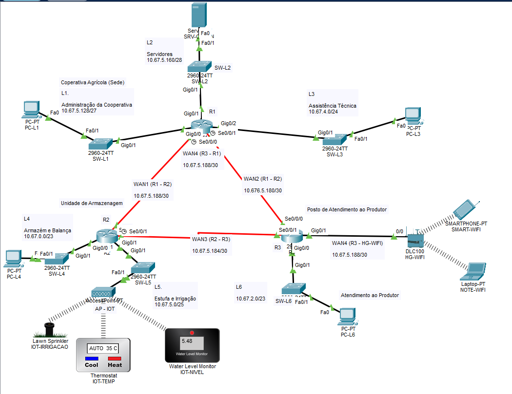

*Figura 1 — Topologia geral montada no Cisco Packet Tracer, com os roteadores R1–R3, seis switches, servidor, Home Gateway, AP-IOT e dispositivos finais. Os rótulos indicam as redes locais; os endereços específicos das interfaces e enlaces constam da seção 4 e do plano VLSM.*

# 6. Resumo das configurações

## 6.1. Configuração básica, segurança e roteamento

Os roteadores foram configurados com hostnames `R1`, `R2` e `R3`. Os switches seguem `SW-L1` a `SW-L6`. O roteamento do anel é **exclusivamente RIPv2**, sem rotas estáticas entre roteadores e sem VLANs adicionais. Configuração comum:

```text
router rip
 version 2
 network 10.0.0.0
 no auto-summary
```

As tabelas de rotas apresentaram redes diretamente conectadas (`C`), endereços locais (`L`) e redes aprendidas pelo RIP (`R`). Os testes T3 e T4 comprovaram comunicação até o servidor e recuperação após falha.

As senhas foram configuradas. A saída atual de `show running-config` do **R2** confirmou `enable secret`, senha de console com `login`, `service password-encryption`, `banner motd` contendo cenário e RMs e descrições nas interfaces em uso. Os arquivos `img/R1config.png`, `img/R2config.png` e `img/R3config.png` documentam a ativação inicial das interfaces.

Registros iniciais: [R1 — configuração inicial](img/R1config.png) · [R2 — configuração inicial](img/R2config.png) · [R3 — configuração inicial](img/R3config.png).

## 6.2. DHCP, DNS e HTTP no SRV-CITIZEN

**Servidor:** `10.67.5.161/28`, gateway `10.67.5.174`. Serviço DHCP habilitado com um pool por LAN de usuários; L2 não utiliza pool de usuários.

| Pool | Início DHCP | Máscara | Gateway | DNS | Máximo de IPs distribuídos |
|---|---|---|---|---|---:|
| L1 | `10.67.5.129` | `255.255.255.224` | `10.67.5.158` | `10.67.5.161` | 28 |
| L3 | `10.67.4.1` | `255.255.255.0` | `10.67.4.254` | `10.67.5.161` | 252 |
| L4 | `10.67.0.1` | `255.255.254.0` | `10.67.1.254` | `10.67.5.161` | 508 |
| L5 | `10.67.5.1` | `255.255.255.128` | `10.67.5.126` | `10.67.5.161` | 124 |
| L6 | `10.67.2.1` | `255.255.254.0` | `10.67.3.254` | `10.67.5.161` | 508 |

Nos roteadores foi aplicado `ip helper-address 10.67.5.161` nas interfaces LAN **R1 G0/0 e G0/2; R2 G0/0 e G0/1; R3 G0/0**. Como o servidor está na L2, R1 G0/1 não precisa desse comando.

**Registros DNS A previstos:** `www.campo.citizentech → 10.67.5.161` e `iot.campo.citizentech → 10.67.5.161`. O serviço HTTP hospeda o Portal do Cidadão com informações sobre o Campo Conectado e os três RMs. O acesso ao portal pelo domínio foi testado nos PCs e no Wi-Fi.

## 6.3. Wi-Fi público

O Home Gateway (`HG-WIFI`) conecta-se diretamente ao **R3 G0/1**, com IP WAN `10.67.5.190/30`, gateway `10.67.5.189` e DNS `10.67.5.161`. Sua rede interna é **`192.168.10.0/24`**, com DHCP próprio, NAT e SSID **`CT-867`**, usando WPA2-PSK/AES. O smartphone e o notebook receberam endereços da rede do HG-WIFI e acessaram o portal pelo nome. No notebook, foi observado `192.168.10.101/24`, gateway `192.168.10.1`, DNS `10.67.5.161`.

O acesso ao portal demonstra que visitantes podem alcançar pelo menos esse serviço interno. A rede separada e o NAT **não garantem isolamento completo** contra acesso a outros destinos privados; proteção adicional por ACL/firewall é o ideal mas não foi implementado.

## 6.4. IoT e automação — nota técnica 

Na rede **L5**, um AP exclusivo (`AP-IOT`) com SSID `CT-IOT` foi conectado ao SW-L5, pois o dispositivo **Thermostat** disponível na versão usada possui interface sem fio, sem adaptador Ethernet. Os três equipamentos **IOT-TEMP (Thermostat)**, **IOT-NIVEL (Water Level Monitor)** e **IOT-IRRIGACAO (Lawn Sprinkler)** aparecem registrados e online no serviço IoT do SRV-CITIZEN (`10.67.5.161`). O Thermostat foi usado como equivalente funcional sugerido no enunciado.

Inicialmente não conseguimos modificar o gráfico da temperatura no painel **Environments** para simular a automação rodando. Corrigimos o problema ajustando o tempo da simulação. 

# 7. Evidências dos testes obrigatórios T1 a T9

## 7.1. T1 — Endereçamento IPv4 por DHCP

Resultado de `ipconfig /all` de um PC em cada LAN de usuários. Cada captura deve exibir IPv4, máscara, gateway e DNS.

**LAN L1 — PC-L1:** rede `10.67.5.128/27`, gateway `10.67.5.158` e DNS `10.67.5.161`.

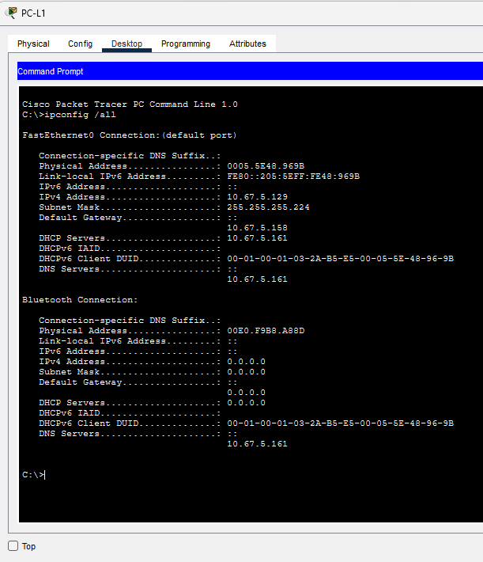

*Figura 2 — Configuração IPv4 de PC-L1 obtida por DHCP.*

**LAN L3 — PC-L3:** rede `10.67.4.0/24`, gateway `10.67.4.254` e DNS `10.67.5.161`.

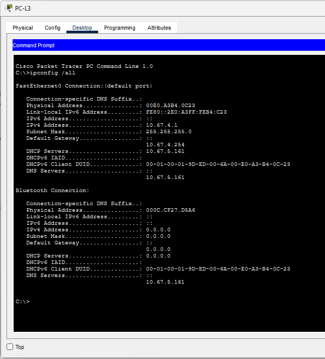

*Figura 3 — Configuração IPv4 de PC-L3 obtida por DHCP.*

**LAN L4 — PC-L4:** rede `10.67.0.0/23`, gateway `10.67.1.254` e DNS `10.67.5.161`.

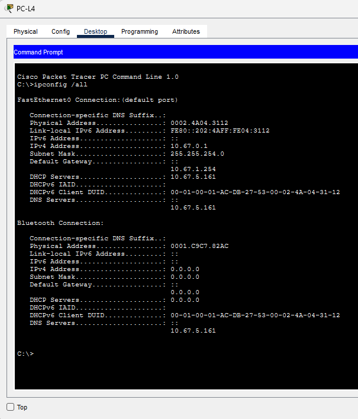

*Figura 4 — Configuração IPv4 de PC-L4 obtida por DHCP.*

**LAN L6 — PC-L6:** rede `10.67.2.0/23`, gateway `10.67.3.254` e DNS `10.67.5.161`.

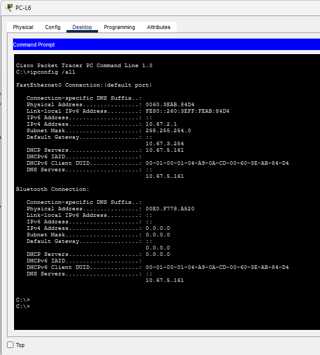

*Figura 5 — Configuração IPv4 de PC-L6 obtida por DHCP.*

## 7.2. T2 — Tabelas de roteamento RIPv2

`show ip route` nos roteadores R1, R2 e R3. Devem constar as redes conectadas (`C`), os endereços locais (`L`) e as rotas aprendidas dinamicamente (`R`).

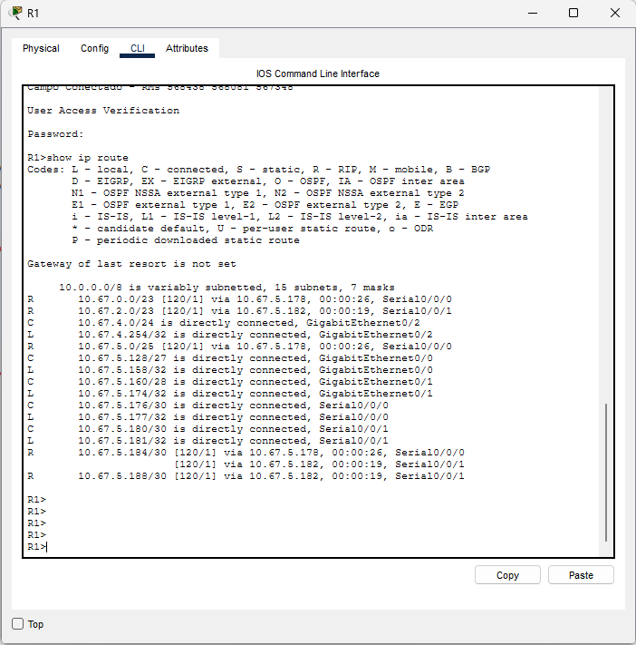

*Figura 6 — Tabela de roteamento de R1.*

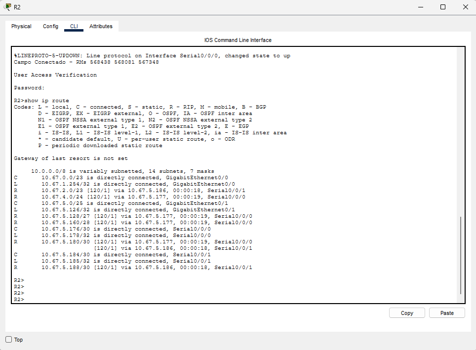

*Figura 7 — Tabela de roteamento de R2.*

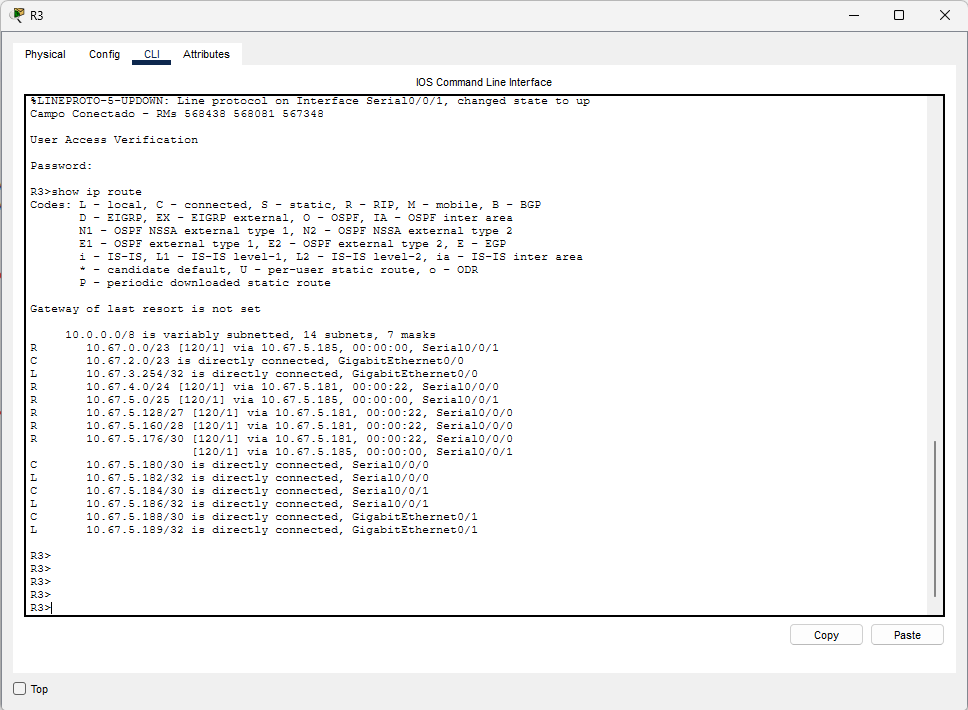

*Figura 8 — Tabela de roteamento de R3.*

## 7.3. T3 — Comunicação entre PC-L4 e SRV-CITIZEN

`tracert 10.67.5.161` demonstrou o caminho normal PC-L4 → R2 (`10.67.1.254`) → R1 (`10.67.5.177`) → SRV-CITIZEN (`10.67.5.161`), em três saltos.


*Figura 9 — Rastreamento do PC-L4 até o servidor. O ping bem-sucedido foi registrado também no teste de redundância.*

## 7.4. T4 — Redundância e recuperação do caminho

**Antes da falha:** o R2 direcionava o tráfego à sede pela WAN1, diretamente para R1 (`10.67.5.177`).

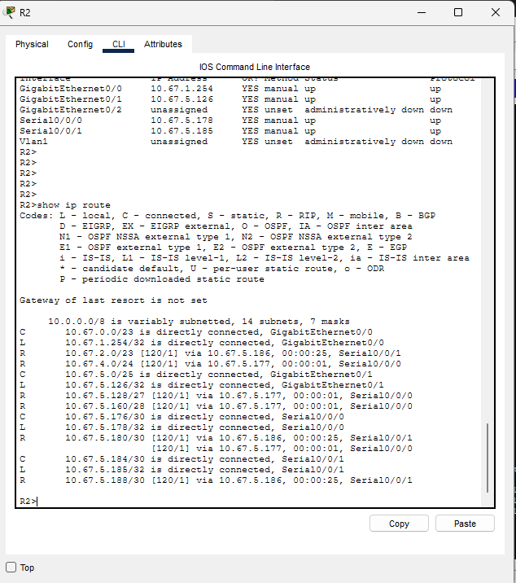

*Figura 10 — Tabela de rotas com WAN1 disponível.*

**Simulação de falha:** `shutdown` em R2 Serial0/0/0 (WAN1).

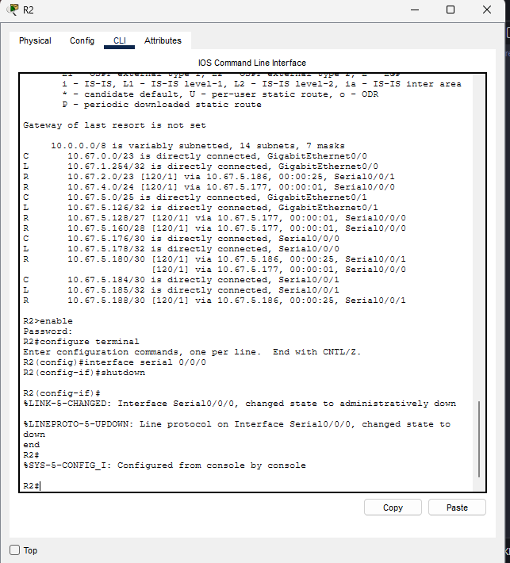

*Figura 11 — Desativação administrativa do enlace R2–R1.*

**Após a convergência:** as redes da sede passaram a ser alcançadas pela Serial0/0/1 do R2, com próximo salto `10.67.5.186` (R3).

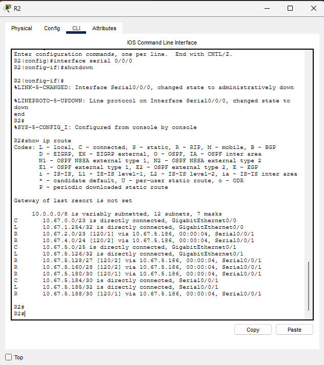

*Figura 12 — Rotas RIP aprendidas pelo caminho alternativo via R3.*

O novo `tracert` mostrou PC-L4 → R2 (`10.67.1.254`) → R3 (`10.67.5.186`) → R1 (`10.67.5.181`) → SRV-CITIZEN (`10.67.5.161`). O ping chegou ao servidor com 4 respostas e 0% de perda.

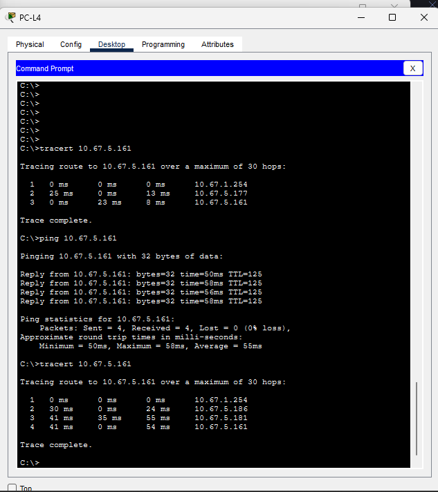

*Figura 13 — Comprovação da redundância: caminho com quatro saltos após desativar a WAN1.*

**Restauração após o teste:** R2 Serial0/0/0 foi restaurado com `no shutdown`.

## 7.5. T5 — Portal do Cidadão no PC-L6

O teste verifica o acesso ao portal `http://www.campo.citizentech` pelo navegador do PC-L6.

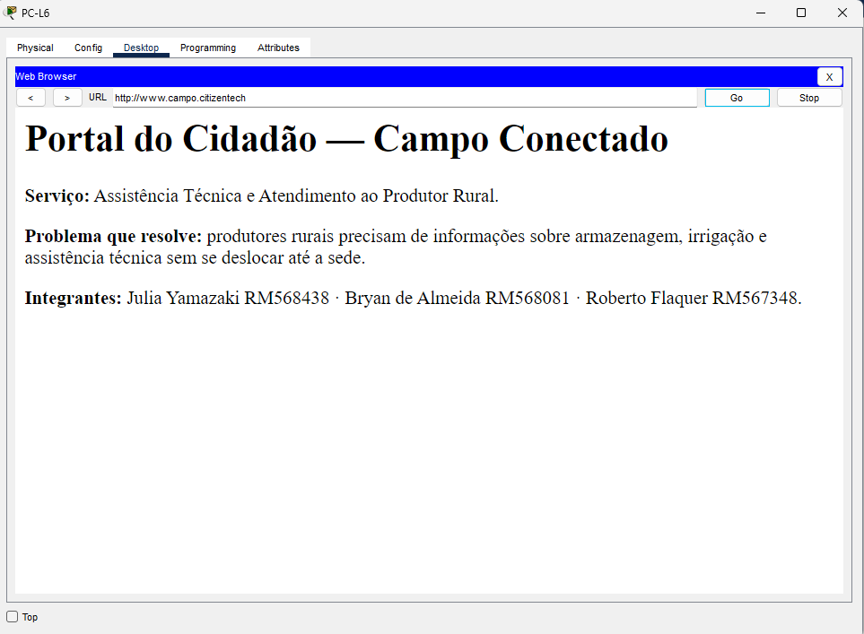

*Figura 14 — Portal do Cidadão; aberta no web-browser do PC-L6*

## 7.6. T6 — Portal do Cidadão no Wi-Fi público

Acesso ao mesmo endereço a partir do SMART-WIFI (smartphone), conectado ao SSID `CT-867` no Home Gateway.

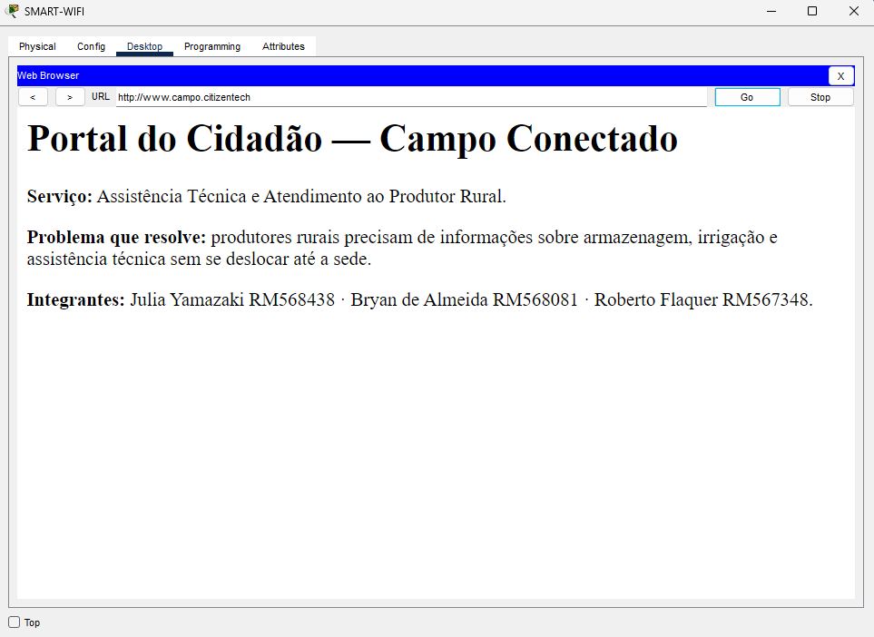

*Figura 15 —  Portal do Cidadão; Acesso pelo smartphone*

## 7.7. T7 — Resolução DNS (pendente de evidência)

`nslookup www.campo.citizentech` com resposta `10.67.5.161`

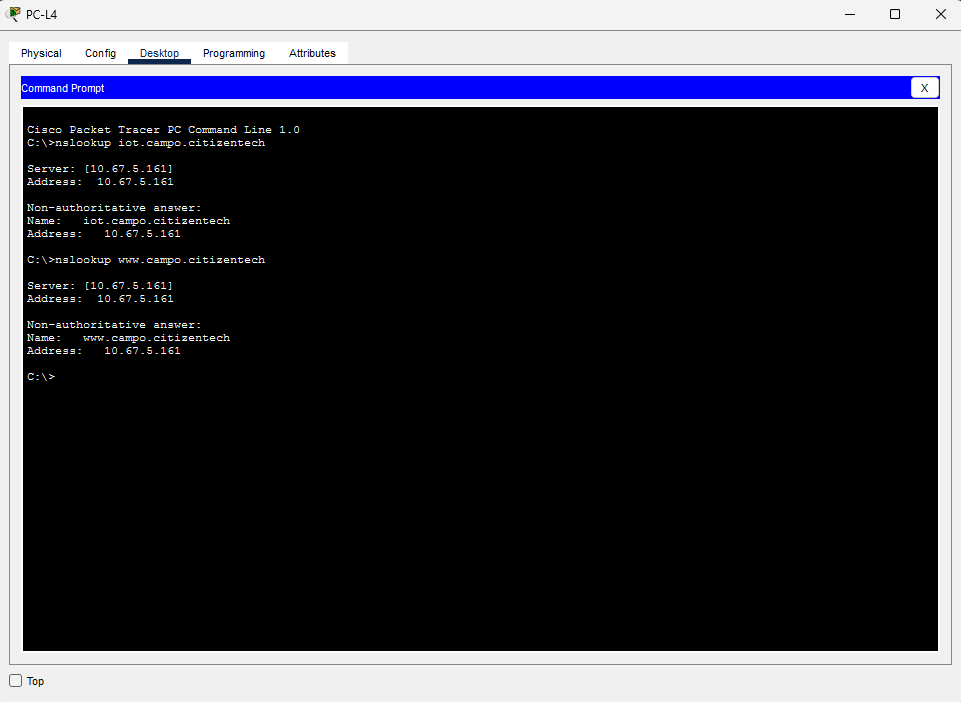

## 7.8. T8 — Registro e automação IoT

O painel acessado pelo PC-L1 mostra IOT-TEMP, IOT-NIVEL e IOT-IRRIGACAO registrados no servidor IoT `10.67.5.161`.

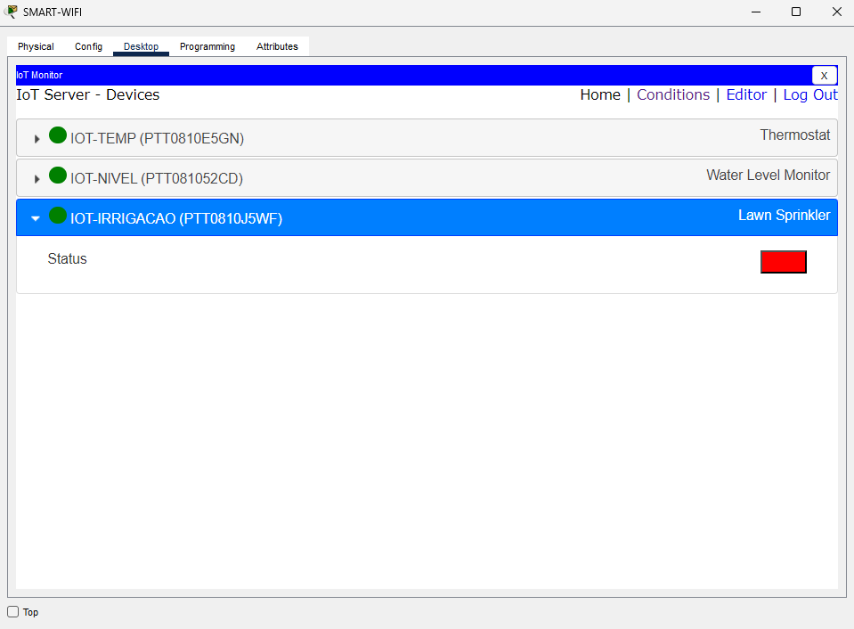

*Figura 16 — Três dispositivos registrados e online.*

A regra `IrrigacaoAutomatica` foi habilitada com a condição **temporária** `IOT-TEMP Temperature > 0.0 °C` SET `IOT-IRRIGACAO Status = true`, devido à dificuldade de simular uma temperatura estável acima de 30 °C (seção 6.4). A falha foi corrigida posteriormente. 

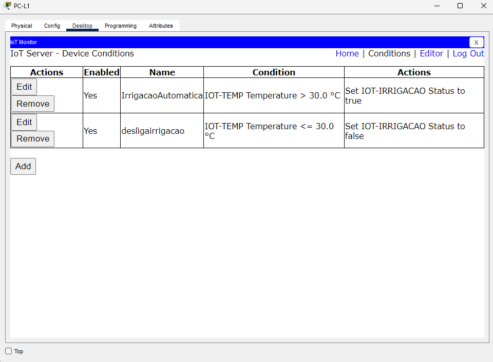

*Figura 17 — Regra IoT habilitada*

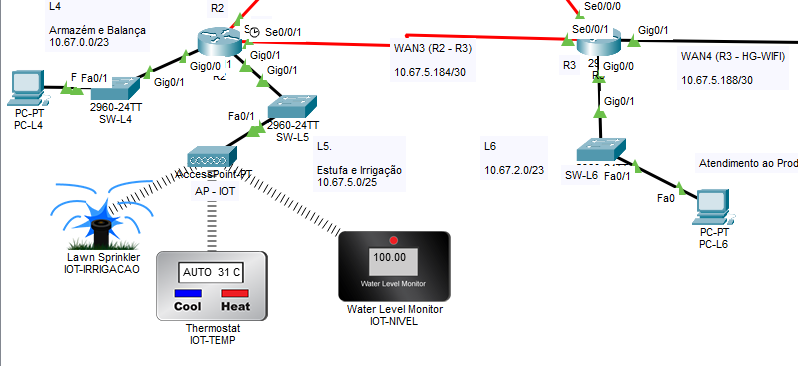

*Figura 18 — Lawn Sprinkler em funcionamento.*

## 7.9. T9 — Gerenciamento do switch 

O teste exige ping de um PC para o IP de gerenciamento do switch de sua própria LAN. 

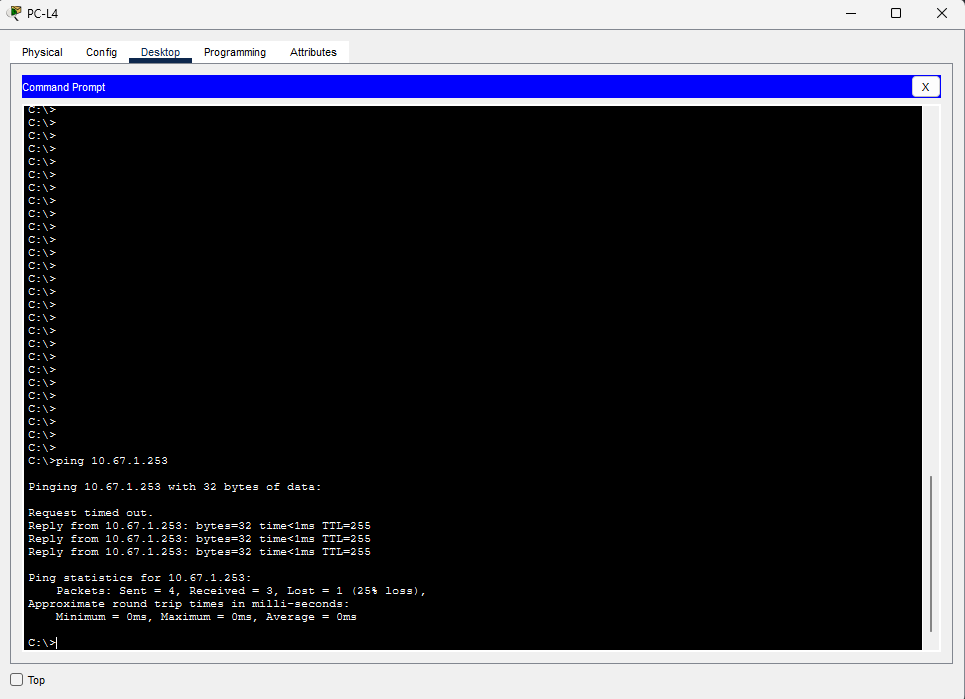.

*Figura 19 — Ping SW-L4.*

# 8. Respostas dissertativas

## 8.1. Impacto para as pessoas (até 15 linhas)

A rede atende os funcionários da cooperativa, os profissionais da unidade de armazenagem e os produtores rurais que procuram orientação e serviços. Uma falha que isolasse a sede prejudicaria o acesso ao servidor `10.67.5.161`, responsável pelo portal e pelos serviços de rede. Isso poderia atrasar atendimentos e interromper consultas feitas pelas unidades remotas. A topologia em anel cria um caminho alternativo: se a WAN1 falhar, R2 pode alcançar R1 passando por R3, por meio do RIPv2. O teste T4 demonstrou essa recuperação: após a desativação da WAN1, o tráfego do PC-L4 chegou ao servidor pelo caminho R2 → R3 → R1, com ping bem-sucedido.

## 8.2. Crescimento

A LAN com maior demanda é a **L4**, com **350 hosts**. O bloco `10.67.0.0/23` fornece `2^9−2=510` endereços utilizáveis: **sobra teórica de 160**. Se a demanda dobrar para **700 hosts**, `/23` não atende (`510 < 700`), mas `/22` atende (`2^10−2 = 1.022 ≥ 700`). A nova máscara seria `255.255.252.0`, com passo de `256−252=4` no terceiro octeto. Expandir L4 para `10.67.0.0/22` ocuparia também `10.67.2.0/23`, atualmente pertencente à L6. Mantendo o requisito de blocos contíguos, **L6, L3, L5, L1, L2 e WAN1–WAN4** precisariam ser realocadas, com atualização de gateways, DHCP, endereços fixos e documentação.

## 8.3. Segurança e privacidade

O Wi-Fi público usa a rede `192.168.10.0/24` atrás do Home Gateway com NAT, separada da faixa `10.67.x.x` das LANs internas. O smartphone consegue acessar `www.campo.citizentech` no servidor `10.67.5.161`, o que confirma acesso ao serviço público, mas **não comprova bloqueio dos demais destinos internos**. Como melhoria de segurança e privacidade, propomos uma ACL ou política de firewall que permita apenas DNS e acesso HTTP/HTTPS ao portal, bloqueando a partir da WAN4 o acesso a redes de gestão e a serviços que contenham dados dos cidadãos. Isso complementaria o NAT e reduziria riscos relacionados à LGPD.

## 8.4. Serviços críticos

O servidor DHCP está na L2 e atende equipamentos de outras LANs. Como broadcasts DHCP não atravessam roteadores por padrão, foi necessário configurar `ip helper-address 10.67.5.161` nas interfaces das LANs de usuários. Se o servidor parar, novas concessões DHCP e renovações podem falhar; DNS, portal HTTP e painel IoT também podem ficar indisponíveis. Clientes que já possuem endereços válidos podem continuar se comunicando por IP durante algum tempo. Como continuidade, propomos um servidor secundário para os serviços essenciais, backup das configurações e procedimento de recuperação documentado.

# 9. Declaração de uso de IA

Utilizamos o Deepseek como apoio na revisão dos cálculos VLSM, na organização do relatório e na conferência dos testes. Os cálculos, as configurações no Packet Tracer, as capturas de tela e as justificativas foram produzidos e validados pelos integrantes. Verificações feitas pelo grupo: recálculo manual do VLSM, execução dos testes T1–T9 no simulador, conferência das tabelas de rotas e das evidências anexadas.

---


